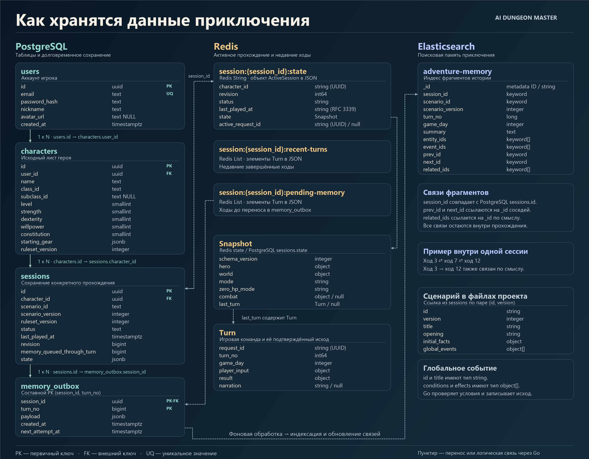

# Схема хранения данных AI Dungeon Master

PostgreSQL хранит аккаунты, исходные листы героев, сохранения и очередь обработки памяти. Redis обслуживает активное прохождение. Elasticsearch хранит значимые фрагменты истории. Во всех трёх хранилищах прохождение связывает один и тот же `session_id`.

## PostgreSQL

`PK` — первичный ключ, `FK` — внешний ключ, `UQ` — уникальное значение. Поля обязательны, если в типе явно не указан `NULL`.

### `users`

| Поле | Тип | Назначение |
| --- | --- | --- |
| `id` | `uuid` | PK. |
| `email` | `text` | UQ. Нормализованный адрес для входа. |
| `password_hash` | `text` | Хеш пароля. |
| `nickname` | `text` | Отображаемое имя. |
| `avatar_url` | `text NULL` | Ссылка на аватар. |
| `created_at` | `timestamptz` | Дата регистрации. |

### `characters`

| Поле | Тип | Назначение |
| --- | --- | --- |
| `id` | `uuid` | PK. |
| `user_id` | `uuid` | FK → `users.id`. Один владелец у персонажа, у владельца может быть несколько персонажей. |
| `name` | `text` | Имя героя. |
| `class_id` | `text` | Класс по справочнику правил. |
| `subclass_id` | `text NULL` | Подкласс после открытия и выбора. Go проверяет уровень и принадлежность к классу. |
| `level` | `smallint` | Исходный уровень. |
| `strength` | `smallint` | Сила. |
| `dexterity` | `smallint` | Ловкость. |
| `willpower` | `smallint` | Воля. |
| `constitution` | `smallint` | Телосложение. |
| `starting_gear` | `jsonb` | Стартовый инвентарь и экипированные слоты. |
| `ruleset_version` | `integer` | Версия справочников при создании листа. |

### `sessions`

| Поле | Тип | Назначение |
| --- | --- | --- |
| `id` | `uuid` | PK, он же `session_id` в Redis и Elasticsearch. |
| `character_id` | `uuid` | FK → `characters.id`. У одного героя может быть несколько прохождений. |
| `scenario_id` | `text` | ID сценария в файлах проекта. |
| `scenario_version` | `integer` | Версия сценария для этого прохождения. |
| `ruleset_version` | `integer` | Версия правил, закреплённая при старте. |
| `status` | `text` | `active`, `completed` или `failed`. |
| `last_played_at` | `timestamptz` | Время последнего сохранённого игрового взаимодействия. |
| `revision` | `bigint` | Версия сохранённого снимка. Go использует её для защиты от устаревшей записи. |
| `memory_queued_through_turn` | `bigint` | Последний завершённый ход, уже поставленный в очередь памяти. До первого хода — 0. |
| `state` | `jsonb` | Снимок прохождения со структурой `Snapshot`. |

При старте Go копирует исходный лист в новое прохождение. Полученные уровни и предметы остаются в его снимке. Исходный лист можно снова выбрать для новой игры. Связи по `class_id`, `subclass_id` и `(scenario_id, scenario_version)` проверяет Go по версионированным справочникам. Доступ к прохождению проверяется через владельца персонажа. [Внешние ключи PostgreSQL](https://www.postgresql.org/docs/current/ddl-constraints.html) · [Тип JSONB](https://www.postgresql.org/docs/current/datatype-json.html)

### `memory_outbox`

| Поле | Тип | Назначение |
| --- | --- | --- |
| `session_id` | `uuid` | FK → `sessions.id`, часть составного PK. |
| `turn_no` | `bigint` | Часть составного PK `(session_id, turn_no)`. |
| `payload` | `jsonb` | Копия завершённого `Turn` с игровым днём, входом игрока, подтверждённым исходом и ответом. |
| `created_at` | `timestamptz` | Время постановки в очередь. |
| `next_attempt_at` | `timestamptz` | Когда фоновый обработчик может взять задание или повторить попытку. |

У прохождения может быть несколько заданий. Это временная очередь. Задание удаляется после решения «не сохранять» или подтверждённой записи фрагмента и обновления связанных записей в Elasticsearch.

## Redis

| Ключ | Тип Redis | Значение |
| --- | --- | --- |
| `session:{session_id}:state` | String | JSON объекта `ActiveSession`. |
| `session:{session_id}:recent-turns` | List | Ограниченный список завершённых ходов. Каждый элемент — JSON объекта `Turn`. |
| `session:{session_id}:pending-memory` | List | Завершённые ходы, ещё не перенесённые в `memory_outbox`. Каждый элемент — JSON объекта `Turn`. |

В `ActiveSession` лежат `character_id` (UUID в строке), `revision` (int64), `status` (строка со значениями из `sessions.status`), `last_played_at` (дата и время RFC 3339), `state` (объект `Snapshot`) и `active_request_id` (UUID в строке или `null`, если команда завершилась). Сам `session_id` берётся из ключа. [Типы данных Redis](https://redis.io/docs/latest/develop/data-types/)

### Содержимое `Snapshot` и `Turn`

| Поле `Snapshot` | Тип JSON | Содержимое |
| --- | --- | --- |
| `schema_version` | integer | Версия формата снимка. |
| `hero` | object | Текущий лист героя. |
| `world` | object | Текущее состояние мира. |
| `mode` | string | `story` или `combat`. |
| `zero_hp_mode` | string | `hardcore` или `severe_injury`. Для одиночной игры по умолчанию `hardcore`. |
| `combat` | object / null | Активный бой. |
| `last_turn` | `Turn` / null | Последний применённый ход. До первого действия игрока — `null`. Рассказ по уже применённому ходу может ещё генерироваться. |

- **`hero`** содержит `class_id` (string), `subclass_id` (string или null), `level`, четыре характеристики и `hp` (integer), `inventory` (массив предметов), `equipment` (карта слот → ID экземпляра), `effects` (массив записей об эффектах), `spell_slots` (карта круг → остаток ячеек) и `metamagic_slots` (integer). КД и модификаторы Go вычисляет по листу, экипировке и правилам.
- **Предмет** содержит `instance_id` (UUID в строке), `item_def_id` (string) и `quantity` (integer). Стартовый комплект использует те же структуры для предметов и слотов. Свойства оружия и брони берутся по `item_def_id` из версии справочника.
- **`world`** содержит `game_day` и `minute_of_day` (integer), `location_id` (string), `facts` (карта ID → boolean), `actors` (карта ID → объект состояния NPC) и `events` (карта ID → объект с `status` и `turn_no`). NPC, появившиеся по ходу игры, хранятся в `actors`. Для статуса события используются `pending`, `triggered` и `averted`. У `pending` номер хода пустой. `averted` фиксируется, когда событие стало невозможным по правилам сценария.
- **`combat`** содержит `round` (integer), `initiative_order` (string[] с ID участников), `active_actor_id` (string), `distance_zones` (карта отношений между участниками → string), `movement_left` (integer), `action_available` и `bonus_action_available` (boolean).

| Поле `Turn` | Тип JSON | Содержимое |
| --- | --- | --- |
| `request_id` | string (UUID) | ID команды клиента. |
| `turn_no` | int64 | Порядковый номер разрешённой команды внутри прохождения. |
| `game_day` | integer | День по игровому времени после разрешения команды. |
| `player_input` | object | Текст или структурированная боевая команда. |
| `result` | object | Подтверждённый результат Go. Например, броски, изменения ресурсов и событий. |
| `narration` | string / null | Ответ ИИ-Мастера. `null` означает, что рассказ ещё генерируется. |

`revision` растёт при каждом изменении сохраняемого снимка, в том числе при добавлении рассказа. `turn_no` нумерует команды с единицы, `game_day` обозначает время внутри истории. Одна боевая команда в хранилище соответствует одной записи `Turn`. Боевой раунд имеет отдельный номер в `combat.round`.

## Elasticsearch

### Индекс `adventure-memory`

| Поле | Тип Elasticsearch | Назначение |
| --- | --- | --- |
| `_id` | metadata ID (string) | Стабильный ID вида `session_id:turn_no`. Для v0 создаём до одного фрагмента на значимый ход. |
| `session_id` | `keyword` | UUID прохождения в строковом виде. |
| `scenario_id` | `keyword` | ID сценария. |
| `scenario_version` | `integer` | Версия сценария. |
| `turn_no` | `long` | Ход-источник. |
| `game_day` | `integer` | День приключения. |
| `summary` | `text` | Краткое описание значимого эпизода для полнотекстового поиска. |
| `entity_ids` | `keyword` (массив) | ID упомянутых NPC, предметов и других сущностей. |
| `event_ids` | `keyword` (массив) | ID связанных глобальных событий. |
| `prev_id` | `keyword` | Предыдущий сохранённый фрагмент того же прохождения. Отсутствует у первого. |
| `next_id` | `keyword` | Следующий сохранённый фрагмент того же прохождения. Отсутствует у последнего. |
| `related_ids` | `keyword` (массив) | Дополнительные смысловые связи между фрагментами того же прохождения. |

Go сначала фильтрует поиск по авторизованному `session_id`, затем выбирает фрагменты по тексту и ID сущностей. Хронологическая цепочка пропускает ходы, которые классификатор признал незначимыми. Связи по `_id` и `session_id` проверяет приложение. [Типы полей Elasticsearch](https://www.elastic.co/docs/reference/elasticsearch/mapping-reference/field-data-types) · [Поле _id](https://www.elastic.co/docs/reference/elasticsearch/mapping-reference/mapping-id-field)

## Сценарий и глобальные события

Сценарий хранится в версионированном файле. У него есть `id` (string), `version` (integer), `title` (string), `opening` (string), `initial_facts` (карта ID → boolean) и `global_events` (массив). Событие имеет `id` (string), `title` (string), `conditions` (массив проверяемых условий) и `effects` (массив обязательных изменений состояния). Исходные факты мира нужны для вступления и проверки условий.

Например, событие `king_death` срабатывает, если злодей добрался до города, проник в замок, получил доступ к королю и ещё способен действовать. Go проверяет условия по подтверждённому состоянию и при срабатывании фиксирует смерть короля. Если игрок успел вывезти короля, условия могут остаться ложными. ИИ-Мастер предлагает развитие событий, диалоги и изменения мира. Go принимает допустимые изменения, продвигает игровое время по правилам действия и проверяет глобальные события после изменений, от которых зависят их условия. События могут остаться неразыгранными, а дальнейшая история зависит от текущего состояния мира.

## Как проходит сохранение

1. **Игровой ход.** Go проверяет владельца, ID команды и ожидаемую версию снимка. В Redis атомарно сохраняются новый снимок и подтверждённый исход. После генерации ответа Go дописывает рассказ и добавляет завершённый ход в оба списка. При повторе последней применённой команды возвращается её исход или догенерируется рассказ. Старую команду, которую уже нельзя опознать по сохранённым результатам, Go отклоняет при несовпадении ожидаемой версии. [Транзакции Redis](https://redis.io/docs/latest/develop/using-commands/transactions/)
2. **Промежуточное сохранение и выход.** По таймеру, после боя и при выходе Go переносит согласованную версию снимка и новые задания для памяти в PostgreSQL одной транзакцией. При этом Go продвигает `memory_queued_through_turn`, чтобы повтор сохранения не вернул в очередь уже обработанный ход. Старый снимок не перезаписывает новый. Из `pending-memory` удаляются подтверждённо перенесённые задания. При выходе Go ждёт окончания активного ответа. Если ответ оборвался после применения результата, снимок можно сохранить с пустым `narration`, а после возобновления завершить рассказ и поставить ход в очередь памяти. Активное состояние очищается после подтверждённого сохранения той же версии.
3. **Фоновая память.** Один обработчик за раз разбирает очередь конкретного прохождения в порядке ходов. Если ход значим, обработчик записывает фрагмент со стабильным `_id` и связывает его с предыдущим значимым фрагментом. При сбое повтор находит фрагмент по тому же ID и завершает обновление связей. Следующее задание этого прохождения берётся после того, как запись и обновлённые связи доступны поиску. До следующего сохранения новый контекст берётся из недавних ходов Redis. Очередь продолжает работать после выхода игрока.
4. **Возобновление.** Go загружает активную копию из Redis или сохранённый снимок из PostgreSQL. Поиск в Elasticsearch дополняет контекст, а сохранённые факты мира определяют правила и последствия. При потере Redis восстановление ограничено последним подтверждённым снимком.

Для проверки модели запустить два прохождения с одним персонажем. В одном довести злодея до покушения, в другом сорвать план неожиданным действием. Сохранить, загрузить оба прохождения и сверить состояние короля, последний ход и цепочку памяти каждого прохождения.
